# Sistem Informasi Perpustakaan (PHP Native)

Aplikasi CRUD untuk basis data `db_perpustakaan` memakai **PHP Native + PDO + MySQL/MariaDB + Bootstrap 5**.

**Nama:** Daffa Nailur Ridho | **NIM:** 26091397118 | **Kelas:** D

## Fitur
- **Modul Buku**: daftar + pencarian (Read), tambah dengan validasi (Create), ubah kecuali ID (Update), hapus dengan penolakan foreign key error 1451 (Delete).
- **Modul Peminjaman**: daftar dengan INNER JOIN, filter status, penanda terlambat (Read); catat pinjam dengan transaksi (Create); kembalikan buku (Update); hapus transaksi (Delete).
- Prepared statement, escape HTML (anti-XSS), pola Post/Redirect/Get, transaksi `FOR UPDATE`.

## Persyaratan
- **XAMPP** (atau server Apache + MySQL/MariaDB + PHP 8.0+ terpisah) — sudah termasuk PHP, Apache, dan phpMyAdmin.

## Cara Menjalankan
1. **Download / clone** project ini:
   ```bash
   git clone https://github.com/dfr09/perpus-php.git
   ```
2. **Pindahkan** folder project ke `C:\xampp\htdocs\perpus-php`.
3. **Start Apache & MySQL** di XAMPP Control Panel.
4. **Import database** — buka `http://localhost/phpmyadmin` → tab **Import** → pilih file `database/db_perpustakaan.sql` → klik **Go**.
5. **Buka aplikasi** di browser: <http://localhost/perpus-php/>.

Aplikasi sudah terhubung otomatis ke MySQL dengan kredensial default XAMPP (user `root`, password kosong).

**Alternatif tanpa Apache:** ubah `BASE_URL` menjadi `''` di `config/config.php`, lalu jalankan `php -S localhost:8000` di dalam folder project dan buka <http://localhost:8000/>.

**Kredensial database** (ubah di `config/config.php` bila perlu):
- Host: `localhost`
- Database: `db_perpustakaan`
- User: `root` / Password: *(kosong)*

## Struktur
```
perpus-php/
|-- index.php
|-- config/config.php
|-- includes/ (functions.php, header.php, footer.php)
|-- assets/css/style.css
|-- buku/ (index, tambah, edit, hapus, _form)
|-- peminjaman/ (index, tambah, kembalikan, hapus)
|-- database/db_perpustakaan.sql
`-- screenshots/
```

## Tampilan Hasil

### 1. Daftar Buku (Read)
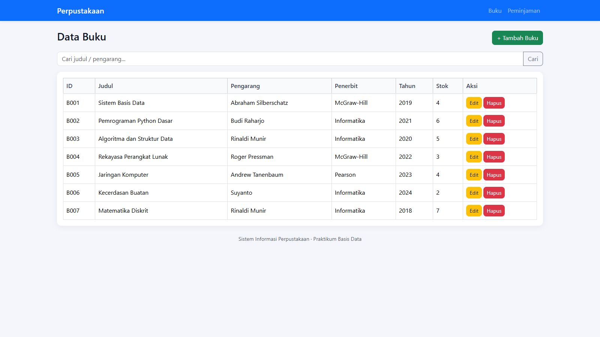

### 2. Pencarian "munir"
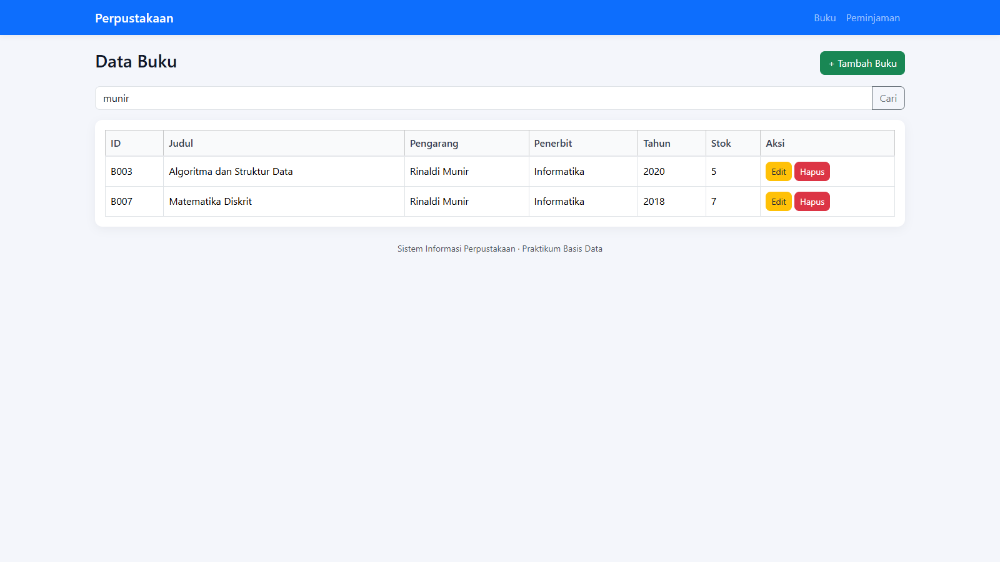

### 3. Tambah Buku B008 (Create)
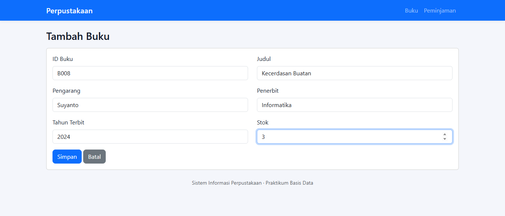

### 4. ID Duplikat Ditolak (error 1062)


### 5. Validasi Format ID Salah
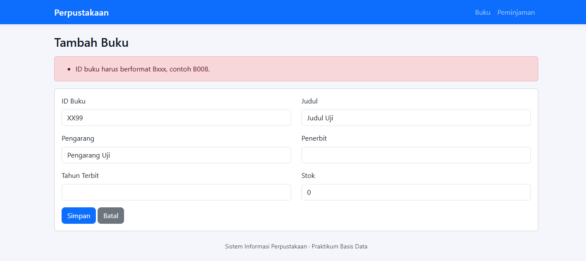

### 6. Edit Buku (Update)
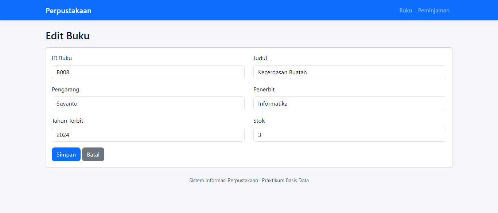

### 7. Hapus Buku B008 (Delete)
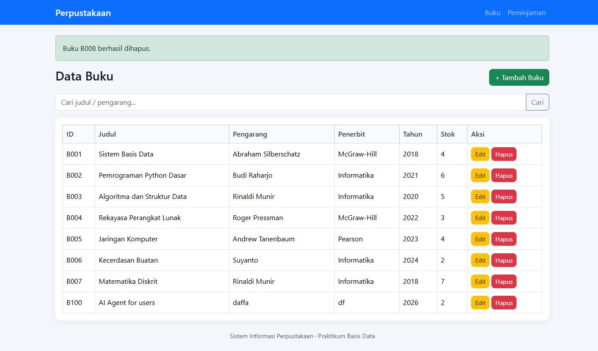

### 8. Hapus B001 Ditolak (error 1451)
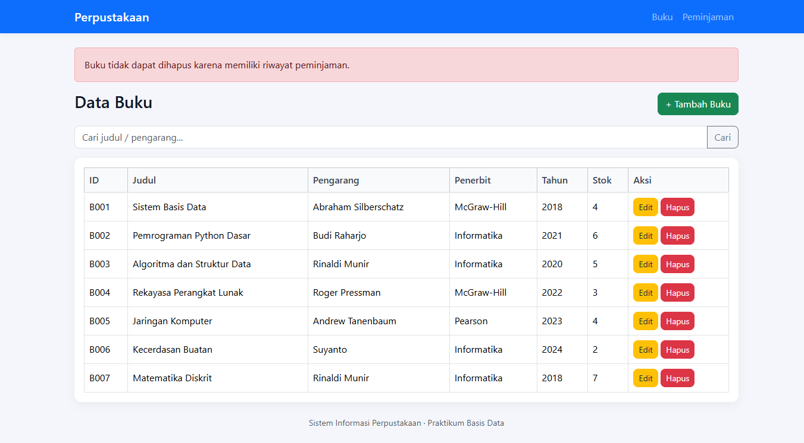

### 9. Daftar Peminjaman (JOIN)
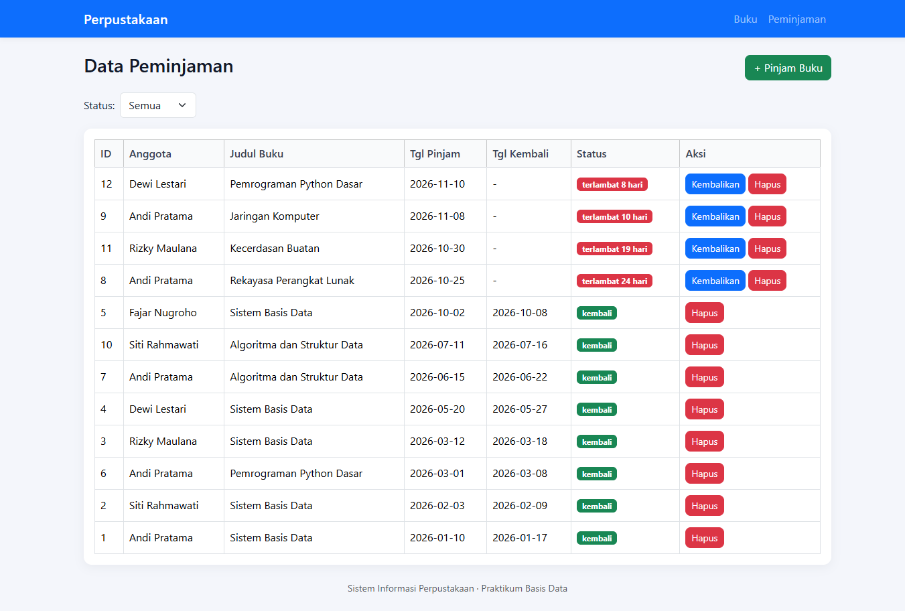

### 10. Filter Status Dipinjam
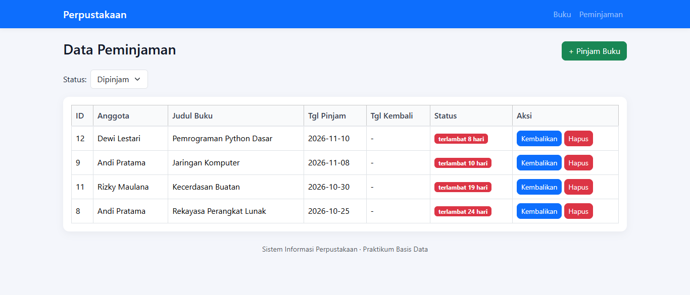

### 11. Catat Peminjaman Baru
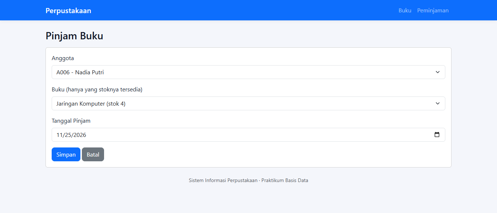

### 12. Kembalikan Buku
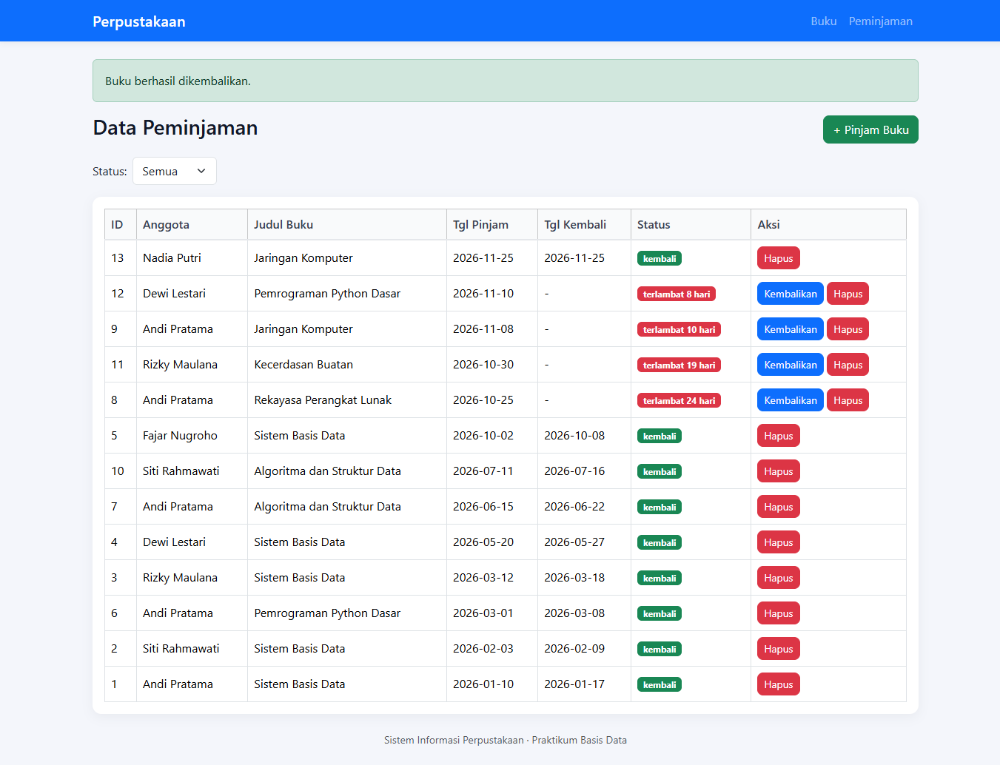
